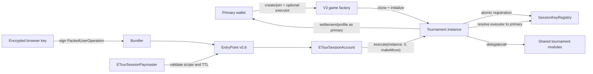

# V3 architecture and trust boundaries

## System outcome

V3 keeps tournament creation, enrollment, gameplay, clocks, escalation,
settlement, and profiles on-chain. It adds a narrow session authorization layer
and ERC-4337 delivery path without transferring player identity or fund
authority to a browser key.



The bundler chooses whether to relay, and the paymaster chooses whether to pay.
Neither can make an invalid move valid, change the bound primary, or access
tournament escrow.

## Contract layers

### Factories and immutable generations

`ETourFactory` owns the one creation pipeline. The three factories supply game
implementation creation and optional post-initialization behavior:

- `TicTacChainFactory`
- `ConnectFourFactory`
- `ChessOnChainFactory`

Each factory deploys one implementation and creates EIP-1167 clones. It records
every clone in `isInstance`, which is later used for session-registration and
paymaster provenance. Implementations and module addresses are immutable for
that deployed factory generation; V3 does not upgrade active clones.

`PlayerRegistry.authorizedFactories` is the profile/enrollment trust anchor.
The fresh V3 registry authorizes only the reviewed V3 factories.

### Instances and canonical game boundary

The inheritance shape is:

```text
ETourStorage
  └─ ETourInstance_Base
       └─ ETourInstance
            └─ ETourGame
                 ├─ TicTacInstance
                 ├─ ConnectFourInstance
                 └─ ChessInstance
```

`ETourInstance_Base` owns initialization, enrollment, profile recording,
accounting, settlement, permanent views, and module dispatch.
`ETourInstance` exposes escalation actions. `ETourGame` centralizes gameplay
identity resolution, clocks, lifecycle, completion, and protected module
bridges. Concrete games implement legal moves and game-specific state only.

This single `makeMove` boundary is why delegated authority is reviewable: all
three games resolve an executor in one shared layer, and no other instance
entry point performs that resolution.

### Shared delegatecall modules

The four shared modules are deployed once:

- `ETourInstance_Core`
- `ETourInstance_Matches`
- `ETourInstance_Prizes`
- `ETourInstance_Escalation`

Instances call them with `delegatecall`, so module code executes against
instance storage and balance. Modules inherit only `ETourStorage` plus the
storage-free `ETourModuleGuard`; they do not inherit the full instance API.
Direct module calls are rejected by an immutable delegatecall sentinel.

Modules re-enter the host through `IETourInstanceSelf`. All six mutable host
bridges require `msg.sender == address(this)`. EOAs and unrelated contracts
cannot invoke them. The complete bridge table is in
[`self-call-bridges.md`](./self-call-bridges.md).

## Canonical storage

Delegatecall safety depends on an exact storage prefix. `ETourStorage` is the
only declaration of game-independent instance/module state:

- `ReentrancyGuard._status` remains slot 0;
- all 20 V2 state entries preserve semantic label, slot, offset, and type shape;
- `SESSION_REGISTRY` is the first V3 append at slot 44;
- future shared state may only append after the current canonical tail;
- concrete game state follows inherited canonical storage.

The compiler-output comparison in `npm run storage:check` verifies all instance
and module consumers against the reviewed baseline. Details are in
[`storage-layout.md`](./storage-layout.md).

## Primary identity, sessions, and funds

The primary wallet is always:

- the enrolled player and turn owner;
- the profile and tournament-history identity;
- the source of creation/join ETH;
- the refund, redistribution, and prize recipient; and
- the only authority that can refresh or revoke its session.

The session executor is an address in
`SessionKeyRegistry[(instance, primary)]`. Its reverse binding is globally
unique while live. Registration or refresh fixes an exclusive
`validUntil = issuedAt + 3,600 seconds`; equality at `validUntil` is expired.
Rotation/revocation increments generation and invalidates the old reverse
binding.

During `makeMove`, an enrolled caller resolves directly to itself. A
non-enrolled caller must resolve through the exact live registry binding for
that instance. Game state, clocks, match actors, winner, profiles, and payout
use the primary; the move event separately records the executor.

Enrollment, cancellation, force-start, timeout, escalation, replacement,
rescue, profile, settlement, prize, registry, and factory functions never use
session resolution. Permissionless escalation calls remain ordinary calls made
as the actual caller, not as a session's primary.

Tournament fees and prizes remain in the instance accounting path. Paymaster
funds are a separate EntryPoint deposit and cannot debit or receive escrow.

## Atomic enrollment and provenance

Creation and joining accept `sessionExecutor` as the final argument. Zero is an
explicit direct-wallet opt-out. For nonzero registration:

1. the factory or instance performs ordinary paid enrollment;
2. the authenticated instance calls `SessionKeyRegistry.registerSession`;
3. the registry checks factory `isInstance`, registry anchors, factory
   authorization, enrollment, conclusion, uniqueness, and address rules;
4. any failure reverts the entire transaction, including ETH, clone/tier,
   profile, player, tournament, event, and session writes.

No administrator can create, extend, rotate, or revoke a player's registry
record.

## ERC-4337 transport

V3 pins EntryPoint/UserOperation v0.8 at
`0x4337084D9E255Ff0702461CF8895CE9E3b5Ff108`.
`ETourSessionAccountFactory` computes a CREATE2 address from a random browser
owner and salt before deployment. That counterfactual address is registered
during enrollment. The first UserOperation supplies factory init code; later
operations omit it.

`ETourSessionAccount` is non-upgradeable. EntryPoint, browser owner, and factory
are immutable. Its EIP-712 signature is bound to chain and EntryPoint. The
account wraps exactly `execute(instance, 0, gameCalldata)`, while the game
receives an ordinary call.

`ETourSessionPaymaster` validates:

- EntryPoint caller and unpaused policy;
- account-factory provenance;
- approved factory and `isInstance` provenance;
- matching session registry and active executor binding;
- exact account wrapper, zero value, and approved move shape;
- verification, call, pre-verification, paymaster, and maximum-cost bounds.

The on-chain policy is the complete sponsorship authority. There is no
off-chain verifier that can broaden it. Direct-primary gameplay bypasses
account, bundler, and paymaster while preserving game rules.

## Browser trust boundary

The browser generates a secp256k1 owner using `crypto.getRandomValues` and
stores its scalar as AES-256-GCM ciphertext in IndexedDB under a non-extractable
wrapping key. Cross-tab messages carry public state only. Nonce-sensitive work
is serialized across read, construction, signing, submission, and
receipt/timeout reconciliation.

Encryption limits accidental disclosure and backup/telemetry leakage; it does
not defend against same-origin malicious JavaScript. Strict CSP, dependency
pinning, safe DOM handling, disabled session replay, and narrow RPC origins are
part of session-key security.

Cache loss or a new device does not lose tournament state. The primary stages a
new encrypted key, confirms `refreshSession`, verifies the new on-chain
executor, and promotes it locally. Direct-primary moves remain available during
recovery.

## Upgrade, deployment, and rollback model

Contracts are a new immutable deployment generation. Active V2 and V3
tournaments are never upgraded in place. A contract change creates a new
reviewed deployment and frontend routing decision.

Canonical output is isolated under `deployments/<network>/manifest.json`. The
manifest records source commit, compiler settings, EntryPoint/account stack,
all V3 addresses, constructor arguments, artifact hashes, and ABIs. Deployment
and operations procedures are in [`Deployment.md`](./Deployment.md) and
[`Operations.md`](./Operations.md).

Rollback means stopping new V3 creation and routing new activity back to V2. It
does not mutate existing V3 tournaments; users retain the safe gameplay path
appropriate to the incident.

## Enforced review gates

Every contract change must pass:

- complete behavioral, session, security, SDK, and ERC-4337 tests;
- compiler warning and official artifact checks;
- canonical storage-layout comparison;
- exact state-changing selector and ABI allowlists;
- V2-to-V3 compatibility review;
- static and dependency checks;
- secret-output checks;
- gas evidence when relevant; and
- deployed-bytecode size checks, with 24,576 bytes an absolute invalid limit.

The architecture decisions and detailed threat properties are maintained in
[`architecture-decisions.md`](./architecture-decisions.md) and
[`SessionAuthorization.md`](./SessionAuthorization.md).

