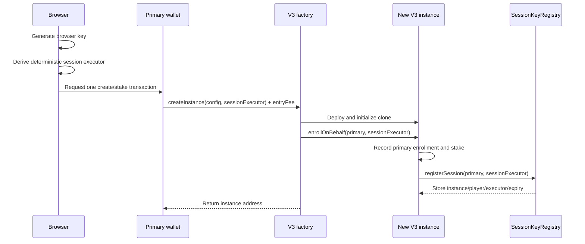
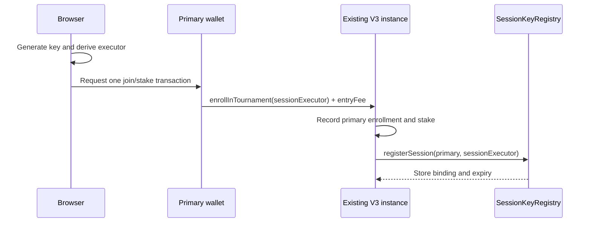
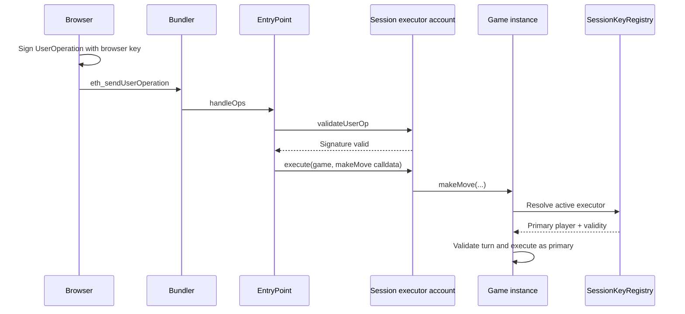
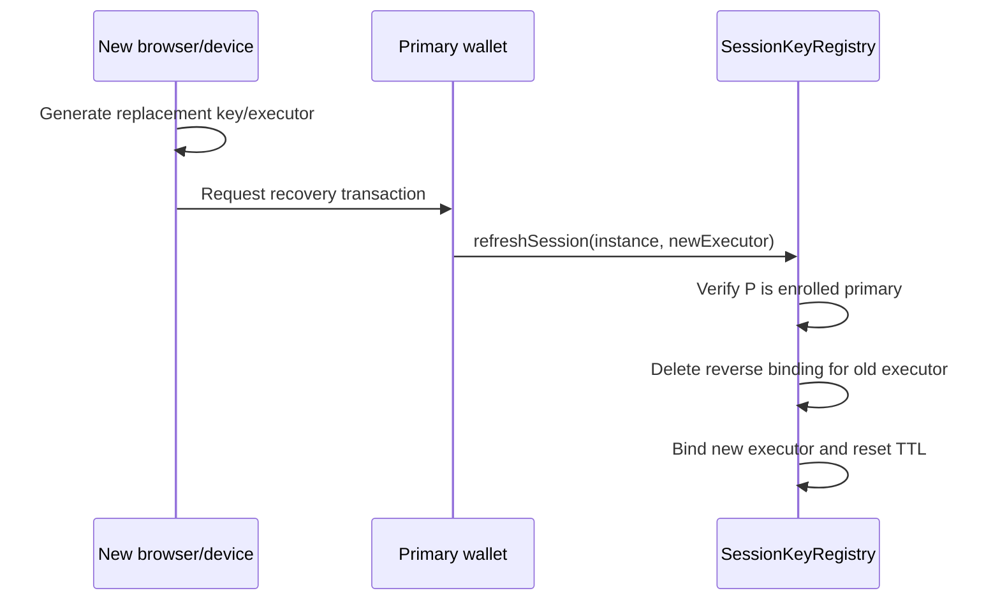

# ETour V3 Implementation Plan

> Status: Implementation — storage/module hardening complete through tracking item 56
> Created: 2026-07-27  
> Scope: Replace `v2/` with a production-ready `v3/` that preserves all V2 behavior and adds instance-scoped, expiring session authorization for zero-friction gameplay.

---

## How to use the V3 implementation documents

The V3 implementation must be managed using these three files together:

- [`v3/plan.md`](./plan.md) is the general technical plan and implementation guide. Read it to understand the intended architecture, requirements, execution phases, security invariants, testing strategy, deployment process, risks, and definition of done. Use this file to guide implementation decisions throughout the entire V3 journey.
- [`v3/tracking.md`](./tracking.md) is the authoritative tracking document. It contains the ordered execution checklist derived from this plan. Developers must use it to determine the next task, mark completed work, and show the current implementation status. A task is not considered tracked as complete until its checkbox is updated there.
- [`v3/logs.txt`](./logs.txt) is the implementation handoff and activity log. Every developer must read it together with the plan and tracking document before beginning work, then update it throughout their work with the latest changes, completed tasks, validation results, important decisions, blockers, and the exact next recommended action.

The working convention is:

1. Read `v3/plan.md` to understand what must be built and why.
2. Read `v3/tracking.md` to identify what has been completed and what must be executed next.
3. Read the latest entries in `v3/logs.txt` to understand the current repository state and where previous developers stopped.
4. Perform the next applicable work using the plan as the guide.
5. Validate the work before declaring it complete.
6. Update the corresponding checkboxes in `v3/tracking.md`.
7. Append a concise, dated handoff entry to `v3/logs.txt` describing what changed, what was validated, any blockers or decisions, and what the next developer should do.

These roles must remain distinct:

- `plan.md` explains the destination and technical approach.
- `tracking.md` records checklist progress.
- `logs.txt` records the latest implementation history and handoff context.

The three files must be kept synchronized. A developer should be able to resume implementation safely by reading them together without relying on undocumented context from another person or task.

Neither `plan.md` nor `tracking.md` is gospel. Both are living documents that developers should revise when implementation work, testing, security review, tooling constraints, or new evidence shows that a different approach, task order, API, or scope detail is necessary. Developers may add, remove, reorder, split, combine, or rewrite plan sections and tracking items as needed, provided that they:

- preserve the core V3 goal of fully replacing V2 behavior while adding secure, instance-scoped session authorization;
- preserve the primary-player identity, escrow, recovery, and session-scope security invariants unless an explicit, reviewed decision changes them;
- document the reason for every material change;
- keep `plan.md` and `tracking.md` consistent with each other;
- record the change and its implementation consequences in `logs.txt`;
- update affected tests, acceptance criteria, risks, and decision records.

The documents exist to support correct implementation, not to force developers to follow assumptions that have become inaccurate. When the code or evidence conflicts with the documents, investigate the conflict, choose the safest technically justified path, and update all three documents so the next developer inherits the current truth.

---

## 1. Purpose of this document

This file is the source of truth for the V3 implementation. It is intended to remain in use throughout design, implementation, testing, auditing, deployment, and migration.

Update this document whenever:

- an architectural decision changes;
- a milestone starts or finishes;
- a risk is discovered or closed;
- an API or storage design changes;
- testing reveals a new required invariant;
- a deployment or migration decision is made.

Status legend:

- `[ ]` Not started
- `[~]` In progress
- `[x]` Complete
- `[!]` Blocked
- `[-]` Deliberately omitted

No V3 milestone is complete merely because code exists. Its tests, documentation, size checks, and acceptance criteria must also pass.

---

## 2. Executive outcome

V3 will be a clean successor to V2, not an in-place upgrade.

It must:

1. Preserve V2 tournament, game, fee, prize, profile, timeout, escalation, and permanent-record behavior.
2. Preserve the three shipped games:
   - Tic-Tac-Toe
   - Connect Four
   - Chess
3. Fix the existing public module-bridge authorization weakness before adding session authorization.
4. Add one active, instance-scoped session executor per enrolled primary player.
5. Permit that executor to call deterministic gameplay functions only.
6. Keep enrollment, escrow ownership, prizes, refunds, cancellation, recovery, and administrative actions bound to the primary player wallet.
7. Enforce an on-chain session expiry and primary-wallet rotation/revocation.
8. Support sponsored ERC-4337 execution on Arbitrum without making game contracts decode `UserOperation` payloads.
9. Make EIP-7702 an optional compatible transport, not a prerequisite for the first V3 release.
10. Ship with complete unit, integration, invariant, adversarial, deployment, and regression coverage.

V3 is done only when it can replace V2 for all new tournaments. Existing V2 instances remain immutable historical contracts and are not upgraded.

---

## 3. Non-negotiable invariants

These invariants take precedence over convenience or backward API compatibility.

### 3.1 Identity and funds

- The primary player address is the enrolled tournament identity.
- The primary player remains the match participant stored in brackets and match state.
- Prizes, refunds, profile records, wins, losses, draws, and earnings are always attributed to the primary player.
- A session executor is never made an enrolled player merely because it submits a move.
- A session executor never becomes a prize recipient through delegated gameplay.
- Session authorization never grants withdrawal, rescue, cancellation, enrollment, fee-management, ownership, or arbitrary-call authority.

### 3.2 Session scope

- A session is bound to exactly one V3 tournament instance and one primary player.
- One executor address may not be bound to multiple live instance/player pairs in the same registry.
- Only `makeMove` selectors are authorized in V3. Any future gameplay selector must be added deliberately and audited.
- Primary wallets retain the ability to make moves directly.
- Rotation invalidates the previous executor immediately.
- Revocation invalidates the current executor immediately.
- Expiry is enforced on-chain using `block.timestamp`.

### 3.3 Tournament behavior

- V2 fee percentages and settlement behavior do not change as part of session authorization.
- A normal move and the same session-authorized move must produce identical game and tournament state.
- Session execution must not alter randomness, bracket selection, timeout accounting, escalation timing, or result calculation except for the transaction sender observed at the transport boundary.
- Completed instances remain immutable permanent records.

### 3.4 Account abstraction

- `EntryPoint`, the smart account, and the paymaster validate `UserOperation` data.
- Game contracts receive ordinary contract calls and do not decode raw `UserOperation` structs.
- Bundlers affect transaction delivery, not game validity.
- Paymaster failure may affect convenience but must never affect the ability of the primary wallet to transact normally.
- The prize pool and player entry fees must never fund sponsored gas unless a later, separately approved economic design explicitly changes the fee model.

### 3.5 RW3 properties

- All authoritative gameplay state and session bindings are on-chain.
- No off-chain database is authoritative for session validity, moves, results, or payouts.
- A hosted bundler or paymaster may be used as transport infrastructure, but protocol correctness cannot depend on trusting it.
- The client must be capable of switching bundlers without changing on-chain state.
- A user can always recover by using the primary wallet on-chain.

---

## 4. Current V2 baseline

V3 begins from the current V2 implementation, not from V1.

Key V2 sources:

- [`ETourInstance_Base.sol`](../v2/contracts/ETourInstance_Base.sol)
- [`ETourInstance.sol`](../v2/contracts/ETourInstance.sol)
- [`ETourFactory.sol`](../v2/contracts/ETourFactory.sol)
- [`TicTacInstance.sol`](../v2/contracts/TicTacInstance.sol)
- [`ConnectFourInstance.sol`](../v2/contracts/ConnectFourInstance.sol)
- [`ChessInstance.sol`](../v2/contracts/ChessInstance.sol)
- [`PlayerRegistry.sol`](../v2/contracts/PlayerRegistry.sol)
- [`PlayerProfile.sol`](../v2/contracts/PlayerProfile.sol)
- [`ETour-V2-OpenSource-Readiness-Plan.md`](../v2/ETour-V2-OpenSource-Readiness-Plan.md)

Baseline verified on 2026-07-27:

- V2 source baseline commit: `3bf167f2600141826d16a6ceaf4a17b357cff205`.
- The complete copy inventory and V3 disposition for all 120 V2 files plus the copied dependency symlink is recorded in [`BASELINE_INVENTORY.md`](./BASELINE_INVENTORY.md).
- 251 V2 tests passing.
- The current compiled `ETourInstance_Matches` module is approximately 97% of the EIP-170 deployed-bytecode limit.
- The three game implementations are approximately 83%–86% of the same limit.
- The compiler currently emits unreachable-code warnings that must be understood and eliminated or explicitly justified in V3.
- Reproducible compile, test, warning, bytecode-size, gas, and storage-layout evidence is stored in [`baselines/README.md`](./baselines/README.md).

### 4.1 Existing issue that must be fixed first

V2 modules invoke instance bridge functions using `this.<function>()` during `delegatecall`. Several bridge functions are public because of that mechanism but do not currently reject direct external callers.

Examples include bridges that can:

- create or reset match state;
- change match players;
- initialize a match;
- complete a match with a supplied result.

V3 must separate:

- external self-call bridges, restricted to `msg.sender == address(this)`; and
- internal game hooks, callable only through protocol code.

Session authorization must not be built on top of an externally mutable match lifecycle.

---

## 5. Clarification of the target architecture

The original feature description combines session authorization and account abstraction. V3 separates them into explicit layers.

### 5.1 Layer 1: Primary identity

The primary wallet stakes ETH, enrolls, owns the tournament identity, receives settlement, and controls recovery.

The primary may be:

- an EOA;
- an ERC-4337 smart account;
- an EIP-7702 delegated EOA;
- another contract wallet capable of making the required calls.

V3 does not assume that the primary is an EOA.

### 5.2 Layer 2: Session authorization

`SessionKeyRegistry` binds a temporary executor address to:

- one V3 instance;
- one enrolled primary player;
- one validity window;
- one generation number.

The instance resolves the executor to the primary player only inside approved gameplay entry points.

### 5.3 Layer 3: Session executor

The preferred V3 executor is a deterministic ERC-4337 smart-account address controlled by a browser-generated key.

Benefits:

- its address can be computed before deployment and registered during enrollment;
- it can be counterfactually deployed on the first move;
- a paymaster can sponsor its `UserOperation`;
- it holds no player stake or prize authority;
- compromise is limited by the game-side instance/TTL policy.

An EIP-7702-delegated browser EOA may later be supported as an alternate executor. It uses the browser EOA address directly while delegating execution logic to a chosen account implementation.

### 5.4 Layer 4: ERC-4337 transport

The browser key signs a `UserOperation` for the session executor. The selected smart-account implementation validates the signature. A bundler submits the operation through a pinned EntryPoint. The session executor calls the game instance.

The game receives:

```text
msg.sender == registered session executor
```

The game then resolves:

```text
registered session executor -> enrolled primary player
```

### 5.5 Layer 5: Sponsorship

A paymaster may sponsor valid move operations. Sponsorship is separate from authorization:

- session registry decides whether an executor may act as a player;
- game rules decide whether the move is valid;
- smart account decides whether the UserOperation signature is valid;
- paymaster decides whether it will pay;
- bundler decides whether and when it will submit.

---

## 6. Target call flows

### 6.1 Create tournament with a session



Registration failure must revert the creation transaction when a non-zero session executor was supplied. Enrollment and session registration must never partially succeed.

### 6.2 Join tournament with a session



### 6.3 Sponsored move



### 6.4 Lost key or new device



The old executor must fail immediately after the refresh transaction is confirmed.

---

## 7. Proposed V3 repository shape

Only this plan exists initially. The intended final layout is:

```text
v3/
├── plan.md
├── README.md
├── package.json
├── hardhat.config.js
├── contracts/
│   ├── abstract/
│   │   ├── ETourInstance_Base.sol
│   │   ├── ETourInstance.sol
│   │   └── ETourGame.sol
│   ├── factories/
│   │   ├── ETourFactory.sol
│   │   ├── TicTacChainFactory.sol
│   │   ├── ConnectFourFactory.sol
│   │   └── ChessOnChainFactory.sol
│   ├── games/
│   │   ├── TicTacInstance.sol
│   │   ├── ConnectFourInstance.sol
│   │   └── ChessInstance.sol
│   ├── interfaces/
│   │   ├── IETourInstance.sol
│   │   ├── IETourInstanceSelf.sol
│   │   ├── ISessionKeyRegistry.sol
│   │   ├── IPlayerRegistry.sol
│   │   └── IPlayerProfile.sol
│   ├── libraries/
│   │   ├── ETourErrors.sol
│   │   ├── ETourTypes.sol
│   │   └── SessionAuthorization.sol
│   ├── modules/
│   │   ├── ETourInstance_Core.sol
│   │   ├── ETourInstance_Matches.sol
│   │   ├── ETourInstance_Prizes.sol
│   │   ├── ETourInstance_Escalation.sol
│   │   └── ChessRulesModule.sol
│   ├── storage/
│   │   └── ETourStorage.sol
│   ├── account-abstraction/
│   │   └── ETourMovePaymaster.sol
│   ├── SessionKeyRegistry.sol
│   ├── PlayerRegistry.sol
│   └── PlayerProfile.sol
├── test/
│   ├── factory/
│   ├── games/
│   ├── session/
│   ├── account-abstraction/
│   ├── invariant/
│   ├── security/
│   └── helpers/
├── scripts/
│   ├── deploy/
│   ├── verify/
│   ├── abi/
│   ├── diagnostics/
│   └── checks/
├── deployments/
├── docs/
│   ├── Architecture.md
│   ├── SessionAuthorization.md
│   ├── AccountAbstraction.md
│   ├── BuildingGames.md
│   ├── Deployment.md
│   ├── Operations.md
│   └── MigrationFromV2.md
└── sdk/
    ├── session/
    └── userops/
```

Notes:

- `artifacts/` and `cache/` are generated, not copied as authoritative source.
- Deployment manifests are regenerated for V3; V2 addresses are never relabeled as V3.
- The exact folder split may change, but responsibilities must remain separated.

---

## 8. Contract architecture refactor

The V2 inheritance structure causes modules to inherit much more executable code than they need. This contributes to bytecode pressure and exposes lifecycle bridges.

### 8.1 Extract shared storage

Create a storage-only base shared by the instance implementations and delegatecall modules.

`ETourStorage` must contain, in a single canonical order:

- initialization state;
- instance and factory references;
- module references;
- session registry reference;
- tier configuration;
- tournament state;
- enrolled-player state;
- round and match state;
- prize state;
- draw state;
- entropy state;
- payout-reason state;
- any game-independent V3 additions.

Rules:

- Do not duplicate storage declarations in modules.
- Do not reorder fields after the V3 storage layout is frozen.
- Append new fields only.
- Generate and compare compiler storage-layout artifacts for the instance and every delegatecall module.
- Fail CI when storage slots diverge.

If `ReentrancyGuard` contributes storage, it must be inherited in the same order through the shared storage base for every contract that accesses instance storage during delegatecall.

### 8.2 Stop modules from inheriting the full instance API

Modules should inherit the canonical storage layout, not all external instance functions.

Module-to-instance calls should use `IETourInstanceSelf(address(this))` and explicit self-call bridge functions.

Benefits:

- removes irrelevant inherited bytecode from modules;
- creates room for V3 features;
- eliminates compiler paths involving reverting abstract stubs;
- makes the trust boundary auditable;
- reduces accidental public APIs.

### 8.3 Protected self-call bridges

Add:

```solidity
modifier onlySelfCall() {
    if (msg.sender != address(this)) revert OnlySelfCall();
    _;
}
```

Apply it to every state-changing bridge used by modules, including the equivalents of:

- create match;
- reset match;
- set match player;
- initialize match for play;
- complete match with result;
- round initialization bridges;
- consolidation bridges.

Read-only bridges may remain public if they reveal only already-public state, but they should still be clearly named and documented.

Add adversarial tests proving direct EOAs and unrelated contracts cannot call any state-changing bridge.

### 8.4 Canonical `ETourGame` abstraction

Move duplicated game lifecycle behavior into `ETourGame`.

It should own:

- effective gameplay-player resolution;
- common match reset;
- common result access;
- common completion state;
- Fischer clock update;
- common escalation-state clearing;
- common move authorization;
- protected module bridges;
- internal game hooks.

Concrete games should implement only game-specific behavior, such as:

- initial board/state;
- move validation;
- board mutation;
- win/draw detection;
- move-history encoding;
- game-specific reset bookkeeping;
- game-state hash for entropy.

### 8.5 Factory initialization hooks

Remove the duplicated `ChessOnChainFactory.createInstance()` pipeline.

The base factory should own one canonical creation flow and expose internal hooks such as:

```solidity
function _initializeInstance(address instance, InstanceInit memory init) internal virtual;
function _postInitializeInstance(address instance) internal virtual;
```

Chess-specific rule-module configuration must use a one-time factory-only post-initialization hook.

This refactor must land before adding the session parameter so the creation flow exists in only one place.

---

## 9. Session registry specification

### 9.1 Constants

Final V3 MVP decision:

```solidity
uint48 public constant SESSION_TTL = 1 hours;
```

The duration is fixed in code for the first V3 release. Changing it requires a new registry/version rather than an admin mutation.

The value was validated against:

- maximum configured enrollment window;
- maximum per-player match clock;
- maximum tournament depth;
- realistic inactive-tab and mobile-resume behavior.

Expiry is expected during long tournaments; refresh is part of normal recovery.
The detailed duration comparison is recorded in
[`docs/architecture-decisions.md`](./docs/architecture-decisions.md). A maximum
Connect Four match can exceed one hour, a 32-player tournament has five rounds,
and Chess has no practical one-hour tournament ceiling. The TTL is therefore a
credential-compromise containment period, not a promise to cover a tournament.

### 9.2 Session record

Proposed logical structure:

```solidity
struct Session {
    address executor;
    uint48 issuedAt;
    uint48 validUntil;
    uint64 generation;
}
```

Recommended mappings:

```solidity
mapping(address instance => mapping(address player => Session)) sessions;
mapping(address executor => ExecutorBinding) executorBindings;
```

`ExecutorBinding` should identify:

- instance;
- primary player;
- generation or active flag.

A global reverse binding prevents accidental reuse of one live executor across multiple instances. Rotation or revocation clears the old binding.

### 9.3 Required registry API

Exact names may change, but the behavior must include:

```solidity
function registerSession(address player, address executor) external;
function refreshSession(address instance, address newExecutor) external;
function revokeSession(address instance) external;
function getSession(address instance, address player) external view returns (Session memory);
function resolveSession(address instance, address executor)
    external
    view
    returns (address player, uint48 validUntil, uint64 generation);
function isSessionActive(address instance, address player, address executor)
    external
    view
    returns (bool);
```

### 9.4 Registration rules

`registerSession` is called by the tournament instance, so the registry namespace is `msg.sender`.

It must require:

- `player != address(0)`;
- `executor != address(0)`;
- `executor != player`;
- the instance reports `player` as enrolled;
- the executor has no other live registry binding;
- no active session already exists for the player unless the call is an explicitly supported initial replacement flow.

Registration sets:

- `issuedAt = uint48(block.timestamp)`;
- `validUntil = uint48(block.timestamp + SESSION_TTL)`;
- generation to the next non-zero value.

### 9.5 Refresh rules

`refreshSession(instance, newExecutor)` is called directly by the primary player.

It must require:

- the target instance reports `msg.sender` as enrolled;
- the new executor passes all registration constraints;
- the new executor is not the current executor;
- the target is a compatible V3 session host.

Refresh must:

1. remove the old reverse binding;
2. increment generation;
3. set the new executor;
4. reset `issuedAt` and `validUntil`;
5. emit one authoritative rotation event.

Refresh may remain possible after a tournament concludes because it cannot bypass `notConcluded`; however, the preferred behavior is to reject concluded instances for clean lifecycle semantics. Finalize this during registry API implementation.

### 9.6 Revocation rules

Only the enrolled primary may revoke its session.

Revocation must:

- remove the reverse binding;
- clear executor and expiry;
- increment generation so stale signed data cannot be confused with a later session;
- emit a revocation event.

The primary can continue making direct moves after revocation.

### 9.7 Events

At minimum:

```solidity
event SessionRegistered(
    address indexed instance,
    address indexed player,
    address indexed executor,
    uint48 validUntil,
    uint64 generation
);

event SessionRefreshed(
    address indexed instance,
    address indexed player,
    address indexed oldExecutor,
    address newExecutor,
    uint48 validUntil,
    uint64 generation
);

event SessionRevoked(
    address indexed instance,
    address indexed player,
    address indexed executor,
    uint64 generation
);
```

Event fields and indexes must be finalized before public testnet deployment.

### 9.8 Registry governance

The registry should require no privileged operator for normal use.

Preferred design:

- TTL is immutable/constant.
- Registration authority is the instance for its own namespace.
- Refresh/revocation authority is the enrolled primary.
- There is no owner capable of assigning arbitrary sessions.
- There is no global pause that can freeze legitimate recovery.

If any owner or emergency authority is introduced, document why, constrain it narrowly, and add it to the threat model and audit scope.

---

## 10. Instance and game integration

### 10.1 Initialization

Every V3 instance must store the immutable-for-that-instance registry address during initialization.

Requirements:

- registry address cannot be zero;
- it is set once;
- the factory supplies the same audited registry to all its instances;
- initialization events or views make the registry discoverable.

### 10.2 Enrollment API

V3 intentionally changes the enrollment APIs:

```solidity
function enrollInTournament(address sessionExecutor) external payable;

function enrollOnBehalf(
    address player,
    address sessionExecutor
) external payable;
```

Rules:

- `address(0)` opts out of session registration.
- A non-zero executor must be registered atomically after successful enrollment.
- If registration fails, the whole enrollment transaction reverts.
- Profile registration remains attributed to the primary player.
- Session registration cannot silently fail.

Avoid retaining no-argument overloads unless bytecode and API review finds a compelling compatibility reason. V3 is a new deployment generation, and one canonical signature is safer.

### 10.3 Factory API

Canonical V3 creation API:

```solidity
function createInstance(
    uint8 playerCount,
    uint256 entryFee,
    uint256 enrollmentWindow,
    uint256 matchTimePerPlayer,
    uint256 timeIncrementPerMove,
    address sessionExecutor
) external payable returns (address instance);
```

The factory must:

1. validate configuration and entry fee;
2. deploy and initialize the clone;
3. track it as a valid factory instance;
4. auto-enroll the primary creator;
5. register the optional session through the instance;
6. revert atomically on any mandatory failure.

Add:

```solidity
mapping(address instance => bool) public isInstance;
```

This supports:

- paymaster target validation;
- indexers and clients;
- registry compatibility checks;
- safer factory/instance attestation.

### 10.4 Effective gameplay player

Every `makeMove` begins by deriving:

```solidity
(address player, address executor) = _resolveGameplayActor();
```

Resolution order:

1. If `isEnrolled[msg.sender]`, treat `msg.sender` as both primary and executor.
2. Otherwise query the registry for an active binding scoped to `address(this)`.
3. Require a non-zero enrolled primary.
4. Require `block.timestamp < validUntil`.
5. Return the primary player while retaining the actual executor for observability.

The rest of the game function must use `player`, never `msg.sender`, for:

- participant checks;
- current-turn checks;
- player-one/player-two comparisons;
- piece/color selection;
- winner assignment;
- completion calls;
- next-turn calculation;
- profile and match outcome attribution.

`msg.sender` may be used only as the observed executor.

### 10.5 Authorized selectors

Session resolution is used only in:

- Tic-Tac-Toe `makeMove`;
- Connect Four `makeMove`;
- Chess `makeMove`.

It is not used in:

- enroll;
- cancel tournament;
- reset enrollment window;
- force-start tournament;
- claim abandoned pool;
- claim timeout win;
- force-eliminate a stalled match;
- claim a replacement slot;
- rescue funds;
- factory ownership or withdrawal;
- profile or registry administration.

If session support for timeout claims is desired later, it requires a separate design decision because it changes the meaning of “deterministic gameplay only.”

### 10.6 Events

Move events must distinguish primary identity from executor.

Preferred pattern:

```solidity
event MoveMade(
    bytes32 indexed matchId,
    address indexed player,
    address indexed executor,
    ...
);
```

For direct primary moves:

```text
player == executor
```

For session moves:

```text
player != executor
```

Tournament and match-completion events continue to use the primary player.

### 10.7 Views

Add convenient views without duplicating registry state:

- instance registry address;
- active session for a player;
- whether a supplied executor can currently move for a player;
- resolved gameplay actor where safe and unambiguous.

Views must not imply that an active session is allowed to perform anything other than the explicitly authorized selectors.

---

## 11. ERC-4337 implementation plan

### 11.1 Standards and versions

Pin, do not float:

- EntryPoint version and address;
- account implementation and factory version;
- UserOperation schema version;
- bundler RPC compatibility;
- paymaster interface version;
- client SDK versions.

References:

- [ERC-4337 specification](https://eips.ethereum.org/EIPS/eip-4337)
- [ERC-7769 bundler JSON-RPC](https://eips.ethereum.org/EIPS/eip-7769)
- [EIP-7702 specification](https://eips.ethereum.org/EIPS/eip-7702)
- [Eth-Infinitism account-abstraction repository](https://github.com/eth-infinitism/account-abstraction)

Do not select a version based only on a single provider. Confirm support from:

- the canonical contract deployment;
- at least two Arbitrum-capable bundlers;
- the chosen account SDK;
- the selected paymaster implementation.

Record the final choice in the decision log.

V3 MVP pins:

- `@account-abstraction/contracts@0.8.0`;
- EntryPoint/UserOperation version `0.8`;
- EntryPoint `0x4337084D9E255Ff0702461CF8895CE9E3b5Ff108` on local
  chain 412346, Arbitrum Sepolia 421614, and Arbitrum One 42161.

The machine-readable source is
[`config/account-abstraction.json`](./config/account-abstraction.json). Although
EntryPoint v0.9 exists, V3 remains on v0.8 until both selected Arbitrum bundlers
document and pass integration tests for a later version.

### 11.2 Session account requirements

The selected account must:

- have audited code or a strong public security history;
- support deterministic counterfactual addresses;
- be controllable by one browser-generated secp256k1 key for the initial release;
- validate replay-safe UserOperations bound to chain ID and EntryPoint;
- execute a single target/value/calldata call;
- expose calldata that the paymaster can validate deterministically;
- work on Arbitrum Sepolia and Arbitrum One;
- not require the primary player to own or control the session account after registration;
- allow first-use deployment through the UserOperation.

The session account should not hold player funds. If ETH is accidentally sent to it, recovery semantics must be documented; this does not grant it primary-player authority.

The selected MVP account is the official v0.8 `SimpleAccount` deployed through
`SimpleAccountFactory`, both pinned by the package above. The factory's CREATE2
`getAddress(owner, salt)` supplies the counterfactual address, while
`createAccount(owner, salt)` supports first-UserOperation deployment through the
EntryPoint `SenderCreator`. The account is reference/sample code despite its
public audit history, so the exact v0.8 account, factory, deterministic
deployment, and ETour integration remain in the external audit scope.

### 11.3 Browser key lifecycle

Client requirements:

1. Generate entropy using the browser cryptographic RNG.
2. Never derive the session key from the primary wallet signature alone.
3. Avoid logging or analytics capture of private material.
4. Store the key using the safest supported browser mechanism.
5. Clearly warn that clearing browser storage requires primary-wallet recovery.
6. Generate a fresh key per instance by default.
7. Delete the old local key after confirmed rotation/revocation where practical.
8. Never upload the raw session private key to application servers.

The implementation must document:

- storage format;
- encryption or wrapping mechanism;
- cross-tab synchronization;
- behavior in private browsing;
- mobile browser behavior;
- cache reset behavior;
- key export policy.

### 11.4 UserOperation construction

The SDK/client layer must:

- encode the exact game `makeMove` calldata;
- wrap it in the selected account `execute` calldata;
- query the correct EntryPoint nonce;
- request gas estimates from the bundler;
- attach paymaster data when sponsorship is available;
- sign with the browser key;
- submit via ERC-7769;
- track both UserOperation hash and resulting transaction hash;
- surface simulation and execution reverts separately;
- retry only when replay and nonce safety are understood.

No game contract should contain bundler-specific decoding logic.

### 11.5 Bundler strategy

Production requirements:

- at least two configured bundler endpoints;
- health checks and failover;
- consistent EntryPoint support;
- bounded retries;
- no assumption that submission means inclusion;
- receipt polling with timeout and recovery;
- metrics for rejection reason, latency, inclusion, and revert rate;
- an emergency direct-primary-wallet path.

Self-hosting a bundler is optional and belongs to an operations workstream. It must not block the first contract implementation unless provider testing shows unacceptable dependency risk.

The selected initial providers are Pimlico (primary) and Alchemy (failover).
Both currently document Arbitrum One, Arbitrum Sepolia, and EntryPoint v0.8
support. Provider selection does not replace the later requirement to validate
`eth_supportedEntryPoints`, estimation, submission, and receipts against both
providers on Arbitrum Sepolia.

---

## 12. Paymaster plan

### 12.1 Initial sponsorship policy

The paymaster sponsors only calls that satisfy all of the following:

- sender is the registered active session executor for the target instance;
- target is a V3 instance deployed by an approved V3 factory;
- target selector is the correct `makeMove` selector for that game;
- call value is zero;
- session has not expired;
- supplied gas limits are within configured safety bounds;
- the account execution wrapper matches the pinned account implementation;
- EntryPoint and chain ID match the deployment.

The paymaster must reject:

- arbitrary targets;
- enrollment or staking;
- refresh/revoke;
- timeout/escalation calls;
- prize or rescue calls;
- factory calls;
- calls with ETH value;
- expired, revoked, or rotated executors;
- malformed account wrapper calldata;
- unknown account implementations;
- oversized gas requests.

### 12.2 Funding

Initial production policy:

- paymaster deposit is funded separately from tournament escrow;
- player entry fees and prize pools are never debited;
- the funding wallet, deposit threshold, alert threshold, and refill runbook are documented;
- depletion disables sponsorship but not direct gameplay.

Any future plan to fund gas from protocol revenue requires:

- an explicit economic proposal;
- updated fee accounting;
- player-facing disclosure;
- new invariants and tests;
- separate audit review.

### 12.3 On-chain and verifying paymaster

V3 uses both implementation layers:

1. On-chain policy paymaster
   - Reads factory/registry state.
   - Minimizes centralized authorization.
   - Must satisfy ERC-4337 validation and staking/storage-access rules.

2. Verifying paymaster
   - Off-chain service signs sponsorship approval.
   - Easier rate limiting and abuse prevention.
   - Introduces an availability dependency.

The on-chain policy is authoritative. The verifying signature provides budget,
rate-limit, and abuse controls, but it may only narrow or decline sponsorship;
it must never broaden what the on-chain paymaster accepts.

### 12.4 Abuse and denial-of-service protections

Plan for:

- repeated invalid move attempts;
- deliberately reverting validly signed moves;
- nonce blocking;
- high gas-limit requests;
- many sessions created and abandoned;
- low-cost spam against the sponsorship budget;
- bundler simulation discrepancies;
- paymaster deposit exhaustion.

Rate limits may affect sponsorship, but they must not change on-chain session authorization.

---

## 13. EIP-7702 compatibility

EIP-7702 is formally deferred as a second-stage feature until ERC-4337 session
accounts work end to end locally and on Arbitrum Sepolia.

Goals:

- allow a browser session EOA to delegate to a compatible account implementation;
- keep the session executor address equal to the browser EOA address;
- use ERC-4337 for sponsored UserOperations where supported;
- preserve the same registry, TTL, rotation, and game authorization rules.

Requirements:

- delegation implementation is pinned and audited;
- authorization tuple handling is supported by the client and bundler;
- delegation persistence and revocation are documented;
- session TTL remains enforced by ETour even if EIP-7702 delegation persists;
- delegated account code cannot make the primary wallet identity equal to the session EOA;
- Arbitrum support is proven in integration tests, not assumed.

EIP-7702 support must not delay the ERC-4337 V3 MVP.

---

## 14. Security threat model

### 14.1 Protected assets

- tournament entry fees;
- prize pool;
- owner share;
- bracket and match integrity;
- turn integrity;
- primary-player identity;
- profile history;
- session bindings;
- sponsorship budget;
- primary and session private keys.

### 14.2 Adversaries

- stolen browser session key;
- malicious player;
- malicious outsider;
- malicious or buggy bundler;
- malicious paymaster client/service;
- compromised frontend origin;
- replay attacker;
- front-runner;
- malicious smart-account implementation;
- malicious contract wallet enrolled as a player;
- factory or module deployment misconfiguration.

### 14.3 Required security properties

- A stolen session key can make only currently legal moves for one primary player in one instance before expiry/revocation.
- It cannot transfer or receive the primary player’s prize through delegated gameplay.
- It cannot rotate itself.
- It cannot extend its own TTL.
- It cannot register a second executor.
- It cannot call internal match lifecycle bridges.
- It cannot bypass turn, board, clock, tournament-status, or conclusion checks.
- Rotation wins over stale pending operations once the registry state changes.
- UserOperation replay is rejected by EntryPoint/account nonces.
- Cross-chain and cross-EntryPoint replay are rejected by the account signature domain.
- Direct primary-wallet gameplay remains available if AA infrastructure fails.

### 14.4 Frontend compromise limitation

An XSS compromise may steal the active browser key and submit legal moves until rotation or expiry. Contract scope and TTL are therefore the final containment boundary.

Client hardening must include:

- strict CSP;
- dependency review and lockfiles;
- no unsafe HTML injection;
- secret-free telemetry;
- minimized third-party scripts;
- explicit origin and chain checks;
- isolated session signing code where practical.

### 14.5 Bridge-function security

Treat every public/external state-changing function in the instance ABI as adversarially callable.

Build and maintain a test-generated allowlist of intentional external entry points. CI should flag unexpected new state-changing ABI functions.

---

## 15. Test strategy

### 15.1 Baseline migration

- Copy all V2 tests into V3.
- Update imports, deployment helpers, and changed V3 signatures.
- Do not delete a failing regression test merely because the implementation changed.
- Preserve the behavior represented by all 251 passing V2 tests unless an intentional V3 decision is recorded.
- Record the V2 baseline commit used for the migration.

### 15.2 Session registry unit tests

Cover:

- initial registration;
- zero player;
- zero executor;
- executor equal to player;
- un-enrolled player;
- duplicate player session;
- executor reused in another instance;
- executor reused for another player;
- expiry boundary immediately before and at `validUntil`;
- refresh by primary;
- refresh by non-primary;
- refresh to current executor;
- refresh to already-bound executor;
- old executor invalid after refresh;
- TTL reset after refresh;
- revoke by primary;
- revoke by non-primary;
- repeated revoke;
- generation increments;
- reverse mapping cleanup;
- same player in different instances with different executors;
- concluded-instance policy;
- events and indexed fields.

### 15.3 Enrollment tests

For creator and joiner paths:

- enroll with no session;
- enroll with valid session;
- session registration and stake occur atomically;
- registration failure rolls back enrollment and ETH accounting;
- creator is registered against the newly created instance;
- profile belongs to primary, not executor;
- duplicate enrollment behavior remains unchanged;
- tournament auto-start remains unchanged.

### 15.4 Game tests for all three games

For Tic-Tac-Toe, Connect Four, and Chess:

- primary direct move succeeds;
- active session move succeeds;
- non-participant fails;
- unregistered executor fails;
- expired executor fails;
- revoked executor fails;
- rotated old executor fails;
- replacement executor resumes the same match state;
- wrong-turn session fails;
- illegal move session fails;
- winner is primary;
- emitted player is primary and executor is observable;
- profile outcome belongs to primary;
- prize belongs to primary;
- direct and session executions produce equivalent board and match state.

### 15.5 Scope-isolation tests

From a registered executor, attempt every non-move state-changing function:

- enroll;
- cancel;
- reset enrollment window;
- force start;
- abandoned-pool claim;
- timeout claim;
- ML2 force elimination;
- ML3 replacement;
- rescue;
- factory owner withdrawal;
- ownership transfer;
- player/profile registry administration;
- session refresh;
- session revoke.

The test should distinguish:

- no delegated primary authority; and
- a function that is intentionally permissionless to all ordinary addresses.

A permissionless function must not treat the session executor as the primary player.

### 15.6 Bridge hardening tests

For every state-changing self-call bridge:

- direct EOA call reverts;
- unrelated contract call reverts;
- factory call reverts unless explicitly authorized;
- module-driven self-call succeeds;
- state remains unchanged after rejected calls.

Add an ABI-based test that enumerates all bridge selectors and applies the same negative test table.

### 15.7 ERC-4337 integration tests

Use a local EntryPoint-compatible environment.

Cover:

- deterministic executor address;
- counterfactual deployment on first move;
- valid browser-key UserOperation;
- invalid signature;
- wrong owner key;
- wrong EntryPoint;
- wrong chain domain where testable;
- nonce replay;
- parallel nonce behavior if supported;
- account execution revert;
- game execution revert;
- valid paymaster sponsorship;
- paymaster rejects wrong target;
- paymaster rejects wrong selector;
- paymaster rejects value;
- paymaster rejects expired/revoked session;
- paymaster rejects oversized gas;
- sponsored winning move and payout;
- unsponsored direct fallback.

### 15.8 Invariant and fuzz tests

At minimum:

- `playerPrizes[sessionExecutor]` never increases because of a delegated move.
- A delegated move can mutate only the match for which the resolved primary is the current player.
- Effective player is either `msg.sender` when enrolled or an active registry resolution.
- Expired/revoked executors never change game state.
- Rotation leaves at most one active executor.
- An executor has at most one live registry binding.
- Sum of prize and owner accounting retains V2 fee invariants.
- Tournament conclusion is independent of whether moves were direct or delegated.
- Module and instance storage layouts remain compatible.

### 15.9 Gas and bytecode tests

Track:

- direct normal move;
- sponsored/session normal move;
- direct winning move;
- sponsored/session winning move;
- session registration;
- session refresh;
- session revoke;
- first UserOperation with account deployment;
- later UserOperation without deployment.

Acceptance limits:

- every deployed contract remains below EIP-170;
- target at least 15% bytecode headroom for instance and module contracts;
- no unexplained regression greater than an agreed threshold;
- gas snapshots are committed and reviewed.

Bundlers do not make execution gas flat. Report separate figures for normal and terminal moves.

### 15.10 Static and security analysis

Add:

- Solidity compiler warnings treated as review failures;
- Slither or equivalent static analysis;
- ABI surface diff;
- storage-layout comparison;
- contract-size checks;
- dependency audit;
- secret scanning for deployment outputs;
- test coverage reporting;
- manual privilege and call-graph review.

The initial CI implementation is
[`.github/workflows/v3-ci.yml`](../.github/workflows/v3-ci.yml). It has separate
clean-compile/analysis and complete-suite jobs pinned to the V3 Node and npm
lockfile. The analysis job enforces reviewed compiler-warning, bytecode-size,
storage-layout, ABI-surface, Solhint, and npm-audit baselines.

Baseline findings are not waivers for release. Reductions pass automatically;
new or increased groups fail. The production dependency graph must remain at
zero advisories. The current 54 npm findings are confined to the
development-inclusive legacy Hardhat toolchain and may not increase. The copied
baseline's 42 compiler warnings and 1,107 Solhint findings remain explicit
cleanup debt for later hardening and release gates.

---

## 16. Scripts and tooling migration

Every useful V2 script must be classified:

| V2 script category | V3 action |
|---|---|
| Module deployment | Port and include registry address |
| Factory deployment | Port to canonical factory flow |
| ABI synchronization | Port for V3 ABIs and session APIs |
| Arbitrum verification | Port with V3 constructor arguments |
| Instance diagnostics | Add registry/session inspection |
| Contract-size check | Rewrite paths and enforce headroom |
| Enrollment test script | Add optional session executor |
| Legacy one-off debug script | Archive or deliberately omit with explanation |

New scripts:

- compute deterministic session account address;
- generate a local session key for development only;
- build/sign/send a development UserOperation;
- inspect session binding and expiry;
- rotate/revoke a development session;
- check EntryPoint/bundler compatibility;
- check paymaster deposit/stake;
- compare V3 module storage layouts;
- compare V2 and V3 ABI surfaces;
- run deployment smoke tests;
- produce deployment manifests atomically.

Deployment scripts must never print private keys.

---

## 17. ABI and SDK requirements

### 17.1 ABI outputs

Generate structured deployment files containing:

- chain ID;
- network name;
- git commit;
- compiler version and optimizer settings;
- deployment timestamp;
- EntryPoint version/address;
- account implementation/factory;
- session registry;
- player registry/profile implementation;
- modules;
- chess rules;
- factories;
- game implementation addresses;
- paymaster;
- contract ABIs.

Never overwrite production manifests with localhost addresses.

### 17.2 V3 session SDK

Provide a minimal TypeScript SDK for:

- browser-key generation;
- deterministic executor derivation;
- enrollment argument creation;
- session lookup and expiry display;
- UserOperation move construction;
- bundler submission;
- receipt tracking;
- refresh/revoke preparation;
- direct-wallet fallback.

The SDK should expose game-specific move encoders behind a common interface without hiding on-chain errors.

### 17.3 Error model

Use custom Solidity errors for authorization and session failures where practical:

- session not found;
- session expired;
- session revoked;
- executor already bound;
- not enrolled primary;
- unauthorized gameplay caller;
- only self-call;
- unsupported selector.

Map errors to clear client messages. Do not collapse all failures into “transaction failed.”

---

## 18. Deployment plan

### 18.1 Deployment order

Proposed order:

1. Confirm canonical EntryPoint and bundler support.
2. Deploy PlayerProfile implementation.
3. Deploy PlayerRegistry, or record the approved reused registry.
4. Deploy SessionKeyRegistry.
5. Deploy shared modules.
6. Deploy ChessRulesModule.
7. Deploy three V3 factories; each creates/pins its game implementation.
8. Authorize V3 factories in PlayerRegistry.
9. Deploy/configure paymaster against the selected EntryPoint and factories.
10. Fund and stake/deposit the paymaster as required.
11. Verify all source code.
12. Run deployment smoke tests.
13. Publish immutable deployment manifest.

### 18.2 Networks

Deployment progression:

1. Hardhat/local EntryPoint environment
2. Local Arbitrum-compatible development environment if maintained
3. Arbitrum Sepolia
4. Limited production canary on Arbitrum One
5. General V3 production availability

No mainnet deployment before:

- security prerequisite phases complete;
- all test gates pass;
- source verification succeeds on testnet;
- at least two bundler paths are validated;
- paymaster failure fallback is exercised;
- audit findings are resolved or explicitly accepted.

### 18.3 Verification

Verify:

- factories;
- implementations;
- registry contracts;
- all modules;
- chess rules;
- paymaster;
- any account implementation deployed by ETour.

EIP-1167 clones should be linked in deployment metadata to their verified implementations.

---

## 19. Migration and V2 replacement

### 19.1 Source migration

V3 implementation starts by copying the authoritative V2 source, tests, scripts, docs, and package configuration.

Do not:

- modify V2 while migrating unless a V2 hotfix is separately requested;
- copy generated artifacts as authoritative inputs;
- silently drop tests;
- reuse V2 deployment JSON as V3 output.

### 19.2 On-chain migration

There is no state mutation or implementation upgrade for existing V2 instances.

Policy:

- active V2 tournaments finish on V2;
- completed V2 tournaments remain readable permanently;
- all new tournaments switch to V3 only after launch approval;
- UI/indexing supports both deployment generations during the transition;
- V2 factory creation is hidden or disabled at the application layer after cutover;
- V2 contracts are not destructively removed.

### 19.3 Player profile decision

Decision required before testnet:

1. Reuse the existing PlayerRegistry
   - preserves a continuous profile address/history;
   - requires authorizing V3 factories;
   - couples V3 to an existing V2 deployment.

2. Deploy a fresh V3 PlayerRegistry
   - clean version boundary and deployment set;
   - splits profile history;
   - UI must aggregate V2 and V3 profiles.

Accepted decision: deploy a fresh V3 registry for clean security/version
isolation while preserving V2 history in UI/indexer queries. V3 deployment
scripts must never authorize V3 factories on or publish a V2 registry as V3.

### 19.4 Cutover criteria

V3 replaces V2 for new activity only after:

- V2 behavioral parity is signed off;
- session authorization is audited;
- canary tournaments complete successfully;
- sponsorship monitoring is operational;
- direct-wallet fallback is confirmed;
- V3 documentation and addresses are published;
- rollback means routing new creation back to V2, not mutating existing V3 instances.

---

## 20. Observability and operations

Monitor:

- session registrations, rotations, revocations, and expiries;
- direct versus session move counts;
- UserOperation submission, rejection, inclusion, and revert rates;
- bundler latency and availability;
- paymaster balance, deposit, stake, and spend rate;
- average gas by game and move type;
- account deployment failures;
- registry resolution failures;
- factory creation failures;
- tournament completion and payout failures.

Alerts:

- paymaster balance below warning threshold;
- all bundlers unavailable;
- sharp rise in invalid-session moves;
- repeated paymaster simulation failures;
- deployment manifest mismatch;
- unverified production contract;
- factory/module registry mismatch;
- unexpected owner-balance accumulation;
- payout or profile recording anomalies.

Operational actions must never include altering match results or session bindings without the primary player’s transaction.

---

## 21. Documentation deliverables

Before production:

- `README.md`: V3 overview and local setup.
- `Architecture.md`: storage, modules, factories, instances, and trust boundaries.
- `SessionAuthorization.md`: registry, TTL, scope, recovery, and events.
- `AccountAbstraction.md`: EntryPoint, account, bundler, paymaster, and UserOperation flow.
- `BuildingGames.md`: minimal game extension surface.
- `Deployment.md`: deployment order, configuration, and verification.
- `Operations.md`: monitoring, paymaster refill, bundler failover, incident handling.
- `MigrationFromV2.md`: source and production cutover.
- NatSpec for every public/external V3 API.

User-facing documentation must explain:

- one wallet confirmation is still required to stake/create/join;
- later moves use the temporary session;
- session expiry and recovery;
- clearing browser storage does not lose tournament funds;
- the primary wallet can always resume by rotating the session or moving directly;
- sponsored gas availability is a convenience service, not a consensus guarantee.

---

## 22. Phased implementation roadmap

### Phase 0 — Freeze baseline and decisions

- [x] Record the V2 source commit used for V3.
- [x] Confirm V2 test baseline and gas/size reports.
- [x] Create the initial V3 source tree from V2.
- [x] Inventory every V2 contract, test, script, deployment file, and document.
- [x] Select Solidity, OpenZeppelin, Hardhat, Node, and package versions.
- [x] Select EntryPoint version.
- [x] Select session account implementation/factory.
- [x] Select initial bundler providers.
- [x] Decide paymaster architecture.
- [x] Decide PlayerRegistry reuse versus fresh deployment.
- [x] Finalize TTL.

Exit gate:

- all decisions recorded;
- reproducible V2 baseline;
- no unclassified V2 file.

### Phase 1 — V3 namespace and behavioral parity

- [x] Copy authoritative V2 sources and tests into V3.
- [x] Rename package/config/deployment namespaces.
- [x] Remove stale generated artifacts and addresses.
- [x] Make all migrated V2 tests pass unchanged in behavior.
- [x] Add V3 compile, test, ABI, and size commands.

Exit gate:

- V3 without session changes reproduces the V2 test baseline.

### Phase 2 — Storage and module hardening

- [ ] Extract canonical shared storage.
- [ ] Remove full-instance inheritance from modules.
- [ ] Introduce explicit module interfaces.
- [ ] Add `onlySelfCall`.
- [ ] Protect all state-changing bridges.
- [ ] Add storage-layout CI checks.
- [ ] Eliminate unreachable-code warnings.
- [ ] Re-run all parity tests.
- [ ] Achieve target bytecode headroom.

Exit gate:

- bridge adversarial tests pass;
- storage layouts match;
- V2 behavior remains intact;
- no module is near the deployment limit.

### Phase 3 — Game and factory abstraction

- [ ] Introduce `ETourGame`.
- [ ] Move shared lifecycle and clock code into it.
- [ ] Reduce concrete games to game-specific hooks.
- [ ] Introduce canonical factory initialization hooks.
- [ ] Remove chess creation-flow duplication.
- [ ] Add `isInstance`.
- [ ] Re-run parity, size, and gas tests.

Exit gate:

- one canonical creation flow;
- all three games pass behavior tests;
- extension surface documented.

### Phase 4 — Session registry

- [ ] Implement registry storage and API.
- [ ] Implement registration, expiry, refresh, and revoke.
- [ ] Implement global live-executor uniqueness.
- [ ] Add events and custom errors.
- [ ] Add registry unit, fuzz, and invariant tests.
- [ ] Review lack of privileged mutation paths.

Exit gate:

- registry security properties proven by tests;
- API and events frozen for integration.

### Phase 5 — Enrollment integration

- [ ] Add registry to factory and instance initialization.
- [ ] Update create API with session executor.
- [ ] Update creator auto-enrollment.
- [ ] Update join enrollment.
- [ ] Support zero-address opt-out.
- [ ] Guarantee atomic rollback on registration failure.
- [ ] Update deployment helpers and all enrollment tests.

Exit gate:

- creator and joiner sessions register atomically;
- accounting/profile behavior unchanged.

### Phase 6 — Game authorization integration

- [ ] Implement effective gameplay actor resolution.
- [ ] Update Tic-Tac-Toe move path.
- [ ] Update Connect Four move path.
- [ ] Update Chess move path.
- [ ] Update move events with primary and executor.
- [ ] Add scope-isolation tests.
- [ ] Add direct/session state-equivalence tests.
- [ ] Add payout/profile attribution tests.

Exit gate:

- sessions can make only legal moves;
- primary identity is preserved end to end.

### Phase 7 — ERC-4337 session executor

- [ ] Integrate selected account contracts/dependencies.
- [ ] Add deterministic address derivation.
- [ ] Add local EntryPoint integration environment.
- [ ] Build UserOperation SDK helpers.
- [ ] Test first-use account deployment.
- [ ] Test replay and invalid signatures.
- [ ] Test game reverts and receipt handling.

Exit gate:

- a browser-key UserOperation makes a legal move locally without the primary wallet.

### Phase 8 — Paymaster and bundlers

- [ ] Implement/configure sponsorship policy.
- [ ] Enforce target, selector, value, executor, TTL, and gas bounds.
- [ ] Test abuse cases and deposit exhaustion.
- [ ] Add multi-bundler client failover.
- [ ] Add paymaster monitoring scripts.
- [ ] Prove direct primary fallback.

Exit gate:

- legal session moves are sponsored;
- all unauthorized calls are rejected;
- sponsorship outage does not block protocol gameplay.

### Phase 9 — Arbitrum testnet

- [ ] Deploy complete V3 set to Arbitrum Sepolia.
- [ ] Verify every contract.
- [ ] Publish manifest and ABIs.
- [ ] Validate at least two bundlers.
- [ ] Run complete create/join/move/rotate/revoke/conclude flows.
- [ ] Run long-duration expiry/recovery test.
- [ ] Run all three games to conclusion.
- [ ] Measure actual gas and sponsorship cost.

Exit gate:

- repeatable, documented testnet operation for every critical flow.

### Phase 10 — Audit and remediation

- [ ] Complete internal call-graph and privilege review.
- [ ] Run static analysis and fuzz/invariant campaigns.
- [ ] Freeze public APIs and storage.
- [ ] Obtain external audit focused on:
  - delegatecall storage and bridge authorization;
  - session registry and identity resolution;
  - prize attribution;
  - ERC-4337 account/paymaster validation;
  - deployment configuration.
- [ ] Resolve or explicitly accept every finding.
- [ ] Add regression tests for every fixed finding.

Exit gate:

- no unresolved critical/high findings;
- accepted lower findings documented.

### Phase 11 — Production canary

- [ ] Deploy and verify Arbitrum One contracts.
- [ ] Fund paymaster with a capped canary budget.
- [ ] Enable a limited set of V3 tournaments.
- [ ] Monitor session and sponsorship metrics.
- [ ] Complete canary tournaments for all games.
- [ ] Exercise bundler failover and session recovery.
- [ ] Publish post-canary review.

Exit gate:

- canary success and explicit launch approval.

### Phase 12 — V3 cutover

- [ ] Route all new tournament creation to V3.
- [ ] Keep V2 read support.
- [ ] Publish V2/V3 migration documentation.
- [ ] Publish final V3 addresses and checksums.
- [ ] Archive V2 creation paths in the UI.
- [ ] Continue operational monitoring and incident response.

Exit gate:

- V3 is the default and complete implementation for all new activity.

---

## 23. Definition of done

The V3 project is complete when all of the following are true:

- [ ] Every necessary V2 contract, module, interface, test, script, and document has a V3 replacement.
- [ ] All V2 behavioral regression tests pass in V3.
- [ ] Public lifecycle bridges are protected from external calls.
- [ ] Shared delegatecall storage is mechanically verified.
- [ ] Session registration is atomic with create/join.
- [ ] Session expiry, refresh, and revocation work on-chain.
- [ ] Session moves preserve the primary identity.
- [ ] Session executors cannot exercise delegated financial or lifecycle authority.
- [ ] All three games support direct and session moves.
- [ ] ERC-4337 sponsored moves work on Arbitrum Sepolia and Arbitrum One.
- [ ] Game contracts do not decode UserOperations.
- [ ] Paymaster sponsorship is narrowly scoped and separately funded.
- [ ] Direct primary-wallet fallback works without bundler/paymaster availability.
- [ ] Every deployed contract fits with agreed bytecode headroom.
- [ ] Compiler, static-analysis, storage-layout, and ABI checks pass.
- [ ] External audit is complete and findings are resolved.
- [ ] Production contracts are verified and manifests published.
- [ ] Canary tournaments succeed.
- [ ] V3 documentation and operations runbooks are complete.
- [ ] V3 is the default for all new tournaments.

---

## 24. Risk register

| Risk | Impact | Mitigation | Status |
|---|---|---|---|
| Delegatecall storage mismatch | Critical state corruption | Canonical storage base, compiler layout comparison, integration tests | Open |
| Public bridge remains callable | Critical match manipulation | `onlySelfCall`, ABI enumeration, adversarial tests | Open |
| Session actor accidentally receives prize | Critical fund misattribution | Effective-player abstraction and payout invariants | Open |
| Module exceeds bytecode limit | Deployment failure | Remove full-base inheritance, size CI, 15% headroom target | Open |
| Session key stolen through XSS | Unauthorized legal moves | TTL, instance scope, rotation, CSP, isolated signing | Open |
| Browser cache/device loss | User cannot use old session | Primary refresh/revoke and direct move fallback | Open |
| Tournament exceeds TTL | Expected session expiry mid-play | Clear UX and primary-authorized refresh | Open |
| Bundler outage/censorship | Delayed sponsored moves | Multiple bundlers and direct primary path | Open |
| Paymaster drained by reverting calls | Sponsorship outage/cost | Strict validation, gas bounds, rate limits, capped budget | Open |
| Account/EntryPoint version mismatch | UserOperation failure | Pin versions and test providers before deployment | Open |
| CREATE address not predictable | Cannot pre-register executor | Use deterministic smart-account factory, not game clone address prediction | Open |
| V2 regression during refactor | Broken tournament behavior | Baseline parity phase and full regression suite | Open |
| Fresh profile registry fragments history | UX inconsistency | UI aggregation or explicit reuse decision | Open |
| EIP-7702 tooling inconsistency | Delayed optional support | Keep it post-MVP and retain ERC-4337 executor path | Open |
| Hosted infrastructure conflicts with RW3 goals | Availability dependency | On-chain authorization, provider portability, self-host option | Open |

---

## 25. Decision log

Record decisions in this table rather than allowing implementation choices to remain implicit.

| ID | Decision | Status | Date | Rationale |
|---|---|---|---|---|
| ADR-001 | V3 is a new deployment generation; V2 instances are not upgraded | Accepted | 2026-07-27 | EIP-1167 clones and immutable factory references make in-place feature upgrades inappropriate |
| ADR-002 | Primary wallet remains enrolled identity and settlement recipient | Accepted | 2026-07-27 | Prevents session compromise from reaching escrow or profiles |
| ADR-003 | Session registry is external and instance-scoped | Accepted | 2026-07-27 | Clear authorization boundary and reduced instance storage/code pressure |
| ADR-004 | Game contracts do not decode UserOperations | Accepted | 2026-07-27 | ERC-4337 validation belongs to EntryPoint/account/paymaster layers |
| ADR-005 | Pin ERC-4337 v0.8 `SimpleAccount`/`SimpleAccountFactory` as the initial transport | Accepted | 2026-07-27 | Provider-compatible counterfactual account with first-UserOperation deployment; exact integration remains in audit scope |
| ADR-006 | EIP-7702 is deferred until after the ERC-4337 MVP | Accepted | 2026-07-27 | Limits initial tooling and compatibility risk |
| ADR-007 | Session authorization initially covers only `makeMove` | Accepted | 2026-07-27 | Narrowest deterministic gameplay scope |
| ADR-008 | One globally unique live executor binding per registry | Accepted | 2026-07-27 | Enforces strict per-instance isolation |
| ADR-009 | Session TTL is one hour | Accepted | 2026-07-27 | Deliberately shorter than legal tournament duration; refresh is normal recovery and TTL limits stolen-key exposure |
| ADR-010 | Deploy fresh V3 PlayerRegistry | Accepted | 2026-07-27 | Clean deployment/security boundary; history is aggregated across generations |
| ADR-011 | Paymaster gas is separately funded from escrow | Accepted | 2026-07-27 | Preserves fee and prize invariants |
| ADR-012 | Modules inherit shared storage, not the full instance API | Accepted | 2026-07-27 | Implemented with `ETourStorage`, `ETourModuleGuard`, and `IETourInstanceSelf`; hardens bridges and restores bytecode headroom |
| ADR-013 | Pin EntryPoint v0.8 at `0x4337084D9E255Ff0702461CF8895CE9E3b5Ff108` | Accepted | 2026-07-27 | Canonical address and current two-provider Arbitrum compatibility |
| ADR-014 | Use Pimlico primary and Alchemy failover bundlers | Accepted | 2026-07-27 | Both document Arbitrum One, Arbitrum Sepolia, and EntryPoint v0.8 support |
| ADR-015 | Paymaster uses authoritative on-chain scope plus narrowing verifier signatures | Accepted | 2026-07-27 | Preserves RW3 authorization while enabling operational budget and abuse controls |
| ADR-016 | Freeze identity, escrow, session-scope, and recovery invariants in the architecture decision record | Accepted | 2026-07-27 | Prevents transport convenience from changing protocol authority |
| ADR-017 | Freeze the reviewed state-changing instance ABI in a machine-readable selector allowlist | Accepted | 2026-07-28 | Makes every new mutable entry point an explicit security review and CI decision |

---

## 26. Progress log

Append brief dated entries as work proceeds.

### 2026-07-27

- Created the V3 source-of-truth plan.
- Defined V3 as a full V2 successor with session authorization, bridge hardening, ERC-4337 transport, paymaster scope, testing, audit, and deployment workstreams.
- Copied and validated the isolated V3 baseline: 21 Solidity files compile and
  all 251 copied tests pass.
- Completed tracking items 1–18 for migration, inventory, namespacing,
  reproducibility, baseline evidence, commands, local deployment, and frontend
  ABI synchronization.
- Completed tracking items 19–29 for CI/regression gates and the recorded
  pre-contract PlayerRegistry, TTL, EntryPoint, account, bundler, paymaster,
  EIP-7702, and invariant decisions.
- Completed tracking items 30–43: extracted canonical shared storage, appended
  the session-registry reference, removed full-instance inheritance and stubs
  from all delegatecall modules, introduced the explicit self-call interface,
  and protected every state-changing module bridge with `onlySelfCall`.

### 2026-07-28

- Completed tracking items 44–56: reviewed and allowlisted all 20 unique
  state-changing instance signatures, made unexpected mutable selectors fail
  CI, and added ABI-driven adversarial tests for every protected self-call
  bridge.
- Verified that EOAs and unrelated contracts cannot invoke any bridge and that
  rejected calls preserve canonical storage, balance, tournament, player,
  round, and match state.
- Verified production-module self-calls and a purpose-built delegatecall harness
  can invoke all six bridges through the legitimate host path.
- Normalized compiler storage type graphs so the strict storage-layout gate is
  stable across unrelated AST renumbering while retaining exact structural
  comparison.
- Removed the unreachable-code warning source and tightened the compiler warning
  allowance to zero.
- Clean compilation, all 256 tests, selector/ABI/storage/static/dependency gates,
  and all EIP-170 size limits pass. The next item is the canonical `ETourGame`
  abstraction.
